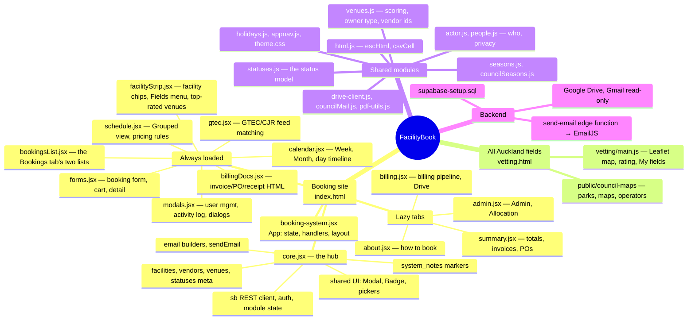
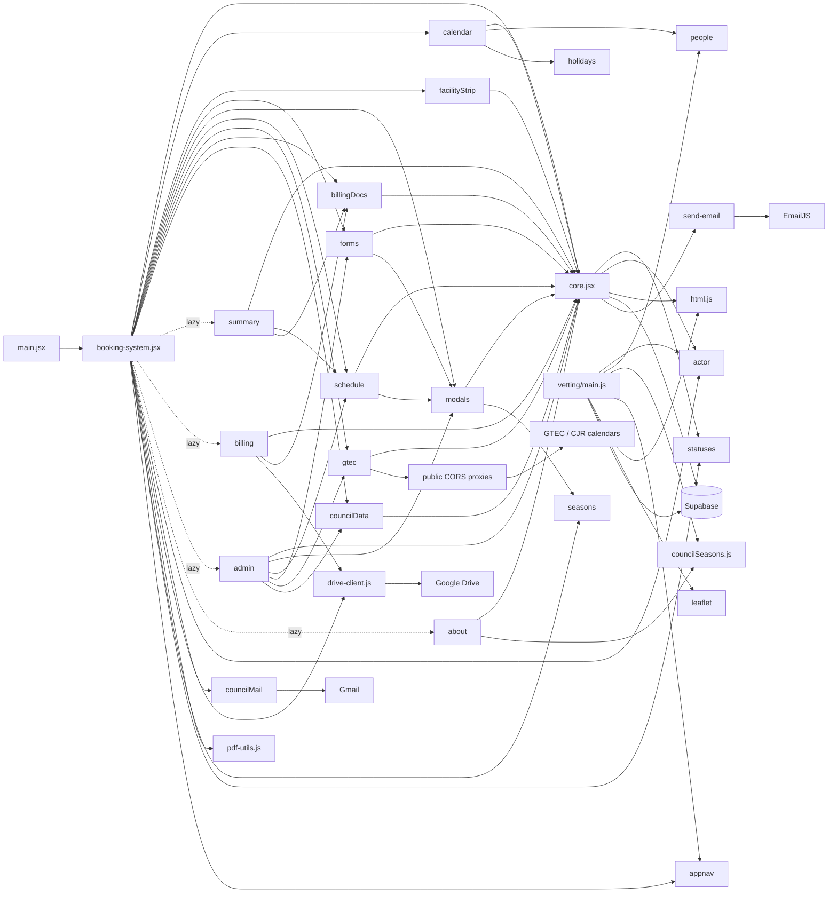

# FacilityBook handover guide

How the two apps fit together, where things live, the data they keep and how to run them.
Read this with [`CLAUDE.md`](../CLAUDE.md) (the hard rules) and [`REVIEW.md`](../REVIEW.md) (the
review checklist). The October 2026 code review and its backlog are in
[`REVIEW-2026-10.md`](REVIEW-2026-10.md).

This guide replaces the old `HANDOFF_SUPABASE_AUTH.md`, `HANDOFF_MULTI_PROVIDER.md` and
`HANDOFF_GROUPED_BOOKINGS.md` (in git history).

## 1. The map

Two pages on GitHub Pages (`/facility-booking/`) share one Supabase project.



Module dependencies (arrows point at what is imported):



Things the picture shows:

- **`core.jsx` is the riskiest file to change.** Every booking module imports it.
- **`booking-system.jsx` holds most of the booking site's state** in one ~2,900-line `App`
  component. It passes it down as props (the Admin tab takes 40+).
- **The two pages share only small modules:** `actor`, `people`, `councilSeasons`,
  `appnav`, `html` and `venues` (scoring, owner type, vendor ids), plus the `settings` table.
- **The shared modules are plain JavaScript** with no imports of their own. They are the
  easiest code to hand over and the only code with unit tests.

## 2. Features by area

### Booking site

| Area | Where | What it does |
|---|---|---|
| Sign-in and identity | `core.jsx` `EmailLoginScreen`, `actor.js` | Google sign-in. A "who's using this login" prompt for shared accounts. Admins can "view as" a booker. |
| Calendars | `calendar.jsx` | Week view: drag to create, NZ holidays. Month view: select and bulk actions. Day timeline per facility. |
| Facility strip | `facilityStrip.jsx`, `topVenues.js` | Facility chips, the 📍 Fields menu (vendor › location › field, plus ⭐ All venues · top rated, which previews unbooked venues), Reset. Also used as the All Bookings list's location filter, which lists every active venue (any booker's active fields) instead of the top-rated list. |
| Booking form | `forms.jsx` `BookingForm`, `facilityPicker.jsx` | Several slots, a day-grid picker, weekly repeat, council application details, booking on someone's behalf. Each slot's field comes from one vendor › location › field dropdown: several fields, a whole location or vendor at once (free ones only; taken ones show what they clash with). |
| Cart | `forms.jsx` `CartModal`, `App.handleCartSubmit` | The single outbox: new bookings and edits, status changes, notices, room requests, invoice emails, shared-slot changes. Nothing is written until **Submit**. Vendor requests (room requests, community field hire requests via `buildCommunityRequestItem`) roll up into one cart item per vendor, so each vendor gets one draft to AMUA's inbox summarising every slot asked for. Submitting new bookings at school / club / trust grounds drafts these straight away (`vendorRequestItems`, tagged `[VREQ]`), unless silent mode is on: silent mode blocks every email, drafts included. The Admin panel's **✉ Request from vendors** (bulk panel and the Grouped view's selection bar) does the same for pending-AMUA bookings. |
| Bookings tab | `bookingsList.jsx` (`BookingsList`, Itemised table or `schedule.jsx` Grouped view) | Two lists: **Filtered Bookings** follows the page's 📍 Fields selection; **All Bookings** has its own location filter (default: every active venue, whichever booker added it, except Cornwall Park's GTEC / CPSA facilities). Each has its own filters, sort and view. The Grouped view's **Vendor-sensitive** option splits each booker into one row per vendor (patterns, status chips, one-offs, totals). |
| Booking detail | `forms.jsx` `BookingDetail` | Status, GTEC mismatch, cost split or fixed price, shared slot, removal. |
| GTEC sync | `App.handleSyncMonth`, `gtec.jsx` | Every 4 h for admins, or by hand. Matches the vendor feed to bookings, flags clashes and mismatches, adds GTEC's own blocks. |
| Council | `App`, `admin.jsx` `CouncilAllocationTab`, `councilMail.js` | Send to council, with the fee split. The council extension reads AMUA's applications from the council portal into `council_outcomes` (and `council_portal_sync`); **🏛 Load portal results** queues the booking changes. Reading the council's replies from Gmail stays as a fallback. Allocate outcomes. |
| Summary | `summary.jsx` | Hours and costs by booker, pricing rules, schedule summary. Invoice / PO builder (draft and official). |
| Billing | `billing.jsx` | Pipeline of official documents, receipts, Drive sync, invoice emails. |
| Admin | `admin.jsx` `AdminPanel` | Activity log, sync results, clashes, mismatch triage, track changes, pricing rules, GTEC purge requests, bookings table. |
| Admin menu | `App`, `modals.jsx` | Rates, player counts, log retention, AMUA details, user management, backup. |

### All Auckland fields (`vetting.html`)

- **Auckland map:** parks coloured by suitability, club and operator markers, council field
  shapes when zoomed in.
- **Park view:**
  - The georeferenced council map over satellite imagery.
  - A to-scale ultimate field you move, turn and rate.
  - "2 × 7v7" splits and light poles.
  - Alignment offsets for the council map.
- **Decisions:** Top / Shortlist / Later / Reject, by swipe, buttons or keys.
- **Shared data:**
  - Reviews, vendor amendments and crowd quality ratings.
  - Every change is logged in `vetting_history`, and admins can reject a change.
- **📌 My fields:** each booker's saved fields. Marking one **bookable** makes it a facility
  on the booking site (`settings.council_facilities`).
- **Retired:** "Book mode" (picking council areas into a cart). Fields reach My fields by
  being rated.

## 3. Data

### Supabase (all in `supabase-setup.sql`, re-runnable, `schema_version` = 9)

| Table / function | Used by | Notes |
|---|---|---|
| `bookings` | both | Every signed-in user can read every booking (the calendars need it). Users write their own rows; admins write any. |
| `settings` (key → jsonb) | both | Everyone signed in reads. Admins write. Partial updates go through `settings_merge()`. |
| `activity_log` | both | Who did what. The admin's retention setting purges old rows (default: 1 month). |
| `mismatch_log` | booking site | Written when GTEC mismatches are resolved. Read only by the backup. |
| `booker_contacts` | both | The council application's key-holder contact. Stores the full name, which the council form needs. |
| `field_reviews`, `field_flags`, `field_ratings`, `vetting_history` | Council fields | Ratings and decisions, vendor amendments, quality stars, change log. |
| `set_my_council_facilities()` | Council fields | Lets bookers save their own My fields list. |
| `is_admin()` | policies | `app_metadata.role = 'admin'`. |

### `settings` keys

- **Booking site:**
  - Rates and pricing: `facility_rates`, `pricing_conditions`, `approx_players`,
    `approx_durations`.
  - People: `email_aliases`, `alias_names`, `booker_seasons`, `amua_org`.
  - Council and contacts: `council_outcomes`, `provider_contact_reviews`.
  - `log_retention_months`.
- **Council fields:** `council_facilities` (also read by the booking site), `council_only_parks`,
  `council_offsets`, `operator_relations`, `vet_park_views`, `vet_park_activity`.

### Data kept only in one browser (localStorage) — a known risk

**These live on one device. Another admin's device doesn't see them, and clearing the browser
loses them.** Only the JSON backup (Admin menu → Backup) captures them, and the app has no way
to restore a backup.

- `fb_billing_records`: the official invoices, POs and receipts, with their pipeline stage,
  GTEC invoice number, payments and Drive file ids. Drive holds copies of the documents
  (PDF/HTML) once someone clicks "Sync to Drive", but not the ledger.
- `fb_profiles`: booker and vendor profiles, including billing details.
- The GTEC matcher's taught links, the GTEC purge log and the sync results.

Moving these into tables is the top item in the review backlog.

### Statuses

`src/statuses.js` is the status model: the stages, each workflow's steps (`gtec`, `council`,
`council_private`, `direct`, `community`) and the groups (`isClosed`, `isLive`,
`reachedVendorQueue`…). The labels name the vendor (`statusLabelFor`). The legacy keys
`pending` and `amua_submit` are converted by the SQL. They are also normalised when rows load
(`core.jsx` `normaliseRows`), which is the only place the app still knows about them. The
browser extension may still write `amua_submit`.

### `system_notes` markers

Machine-written state lives in `bookings.system_notes`, never in the user's `notes`. Each
marker is a bracketed tag plus a payload, one per line. Whoever rewrites the column must keep
the markers it doesn't own.

| Marker | Written by | Meaning |
|---|---|---|
| `[CPSA <YYYY-MM-DD>] Ref <ref> · <url>` | extension | Vendor confirmation reference and link. The date is ISO. |
| `[CPSA-MISMATCH] reason \| reason` | sync / extension | The vendor's values differ from the booking. |
| `[CPSA-GTEC] {…}` | sync | Snapshot of the vendor event the booking was matched to. |
| `[CPSA-ORIG] facility\|start\|duration` | app | The booking before it was amended to the vendor's values. |
| `[CPSA-RES] resolution\|billing\|date` | app | Mismatch resolution (`amended` / `to_correct`) and billing state. |
| `[VENDOR-VAR] vStart\|vDur\|rStart\|rDur` | app | A vendor variance kept on record after confirming. Invoices can footnote it. |
| `[BILLED] facility\|start\|duration` | app | What was invoiced. Later changes show as drift. |
| `[CLASH-PREV] status` | sync | The stage before a clash, restored when the clash clears. |
| `[SPLIT] email:weight\|…` | app | Cost split between co-bookers. |
| `[FNCOST] amount` | app | A fixed price instead of hourly rates. |
| `[SLOT] id\|role\|share` | app | Shared slot: `parent` / `child` / `peer` members, whose shares sum to 1. |
| `[GRP] id` | app | Bookings created together in one form submission. The cart and summary keep them grouped. |
| `[COUNCIL_APP id sentAt fee=share]` | app | Sent to the council in application `id`, with this booker's fee share. |
| `[VREQ ref at]` | app | A field hire request for this new booking (school / club / trust ground) was drafted to AMUA's inbox on submit, in vendor draft `ref`. The Admin "Requested from facility" step then doesn't draft it again. |
| `[COUNCIL_INFO] {json}` | app | Player numbers, use, grade and notes for the council form. |

### Grouped bookings (`[GRP]`)

- One form submission with more than one slot tags every draft with the same `[GRP]` id in
  `BookingForm.expandRows`.
- A single slot's weekly repeat isn't tagged; it groups by weekday pattern as before.
- The cart (`groupDrafts`) and the summary (`buildOverlapPatternMap`, `grp:<id>` patterns)
  present a group as one item.
- A group's members can differ in facility, time and date, so anything that summarises a
  group must not assume they match.

## 4. External services

| Service | Code | Notes |
|---|---|---|
| EmailJS | `supabase/functions/send-email` | Holds the keys as Supabase secrets. Only bookers are emailed: non-admins mail AMUA, themselves and their linked aliases; admins also mail anyone with a booking. Everything else becomes a draft to AMUA's inbox. The browser applies the same rule first (`core.jsx` `sendEmail`). |
| Google Drive | `drive-client.js` | Billing documents, the backup. Needs `VITE_GOOGLE_CLIENT_ID`. |
| Gmail (read-only) | `councilMail.js` | Reads council replies for the Allocation tab. It has **its own OAuth client id hard-coded** (`councilMail.js`), not the env var. |
| GTEC / CJR calendars | `gtec.jsx` | Fetched through free public CORS proxies (a fallback chain, with a paste-the-feed fallback). Fragile: a proxy going away breaks sync until the next one in the chain answers. |
| Map tiles and data | `vetting/main.js` | Esri imagery, LINZ, `public/council-maps` (43 MB of council maps). |
| NZ holidays | `holidays.js` | date.nager.at, cached for a week. |
| Browser extensions | [amua-booking-extension](https://github.com/aucklandmixedultimate/amua-booking-extension) | The CPSA extension submits `queued_cpsa` bookings to GTEC's Sporty and writes `[CPSA …]` markers back. The council extension fills the council's application form. |

### CPSA extension contract

- **What it picks up:** `status = 'queued_cpsa'` (or the legacy `amua_submit`),
  `email <> 'admin'`, and `date >= today`.
- **One request per series.** A series is the same email, facility, weekday, start, duration
  and purpose.
- **After lodging:** set each member row to `pending_cpsa`.
- **Write-back:** write the confirmation to every member's `system_notes` as
  `[CPSA <ISO date>] Ref … · url`. Write `[CPSA-MISMATCH]` only to the member(s) that differ.
- **Never touch app-owned markers:** `[BILLED]`, `[CPSA-ORIG]`, `[CPSA-RES]` and the rest.

## 5. Running it

### Local

```bash
npm ci
cp .env.example .env.local    # VITE_SUPABASE_URL, VITE_SUPABASE_ANON, VITE_GOOGLE_CLIENT_ID
npm run dev                   # http://localhost:5173/facility-booking/
npm run check                 # lint (0 errors), unit tests, build — what CI runs
```

**UI checks without a database:** start the dev server with
`VITE_SUPABASE_URL=http://127.0.0.1:59999 VITE_SUPABASE_ANON=x`. Then put a fake session
under `localStorage["sb-127-auth-token"]`, with `user.app_metadata.role = "admin"` and an
`expires_at` in the future. Data calls fail ("Could not connect to database") but every tab
renders. Check at 390 px and desktop widths.

### Deploy

- **Pushing to `main` deploys** through `.github/workflows/deploy.yml`, which runs lint,
  tests and a build first.
- **Use CI only; don't publish `dist/` by hand.** The workflow keeps old hashed bundles
  (`keep_files`) so cached pages don't go blank. A manual publish would delete them.
- **Repo secrets:** `VITE_SUPABASE_URL`, `VITE_SUPABASE_ANON`, `VITE_GOOGLE_CLIENT_ID`.

### Database and functions

- **Schema:** run the whole of `supabase-setup.sql` in the Supabase SQL editor after any
  change. It is safe to re-run. `select version from schema_version` shows what ran.
- **Email function:** re-deploy `send-email` after changing it. See its
  [README](../supabase/functions/send-email/README.md).
- **Making someone an admin:** run the SQL at the end of `supabase-setup.sql`. They then sign
  out and back in.
- **Open item:** rotate the anon key; an old one is in git history. Then update the repo
  secret.
